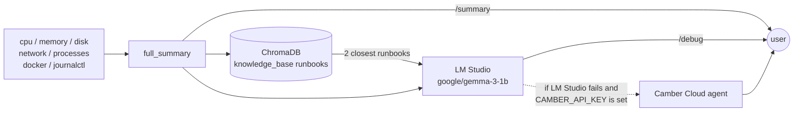

# Linux Debug Assistant

Linux Debug Assistant (LDA) is a FastAPI service and CLI that collects a live health snapshot of a Linux machine. It looks at CPU, memory, disk, network, top processes, Docker and recent `journalctl` errors. When you ask it to debug, it finds matching troubleshooting runbooks in a local ChromaDB store and sends them, together with the snapshot, to a local LLM running in [LM Studio](https://lmstudio.ai/). The model replies with a root cause, fix steps and commands to run.

## How it works



1. **Collect**: `lda/summary.py` runs the collectors in `lda/` and returns one JSON snapshot.
2. **Triage logs**: the last 10 of the latest 50 error-level `journalctl` entries are sorted using the rules in `lda/commands.py`. Known noise (ACPI, BIOS, `bluetoothd`, GNOME, ...) is ignored. Permission, DNS and service failures become `actionable_issues`, each with a suggested action. If any exist, `health` is `degraded`.
3. **Retrieve**: `lda/llm.py` searches the `linux_runbooks` ChromaDB collection with the snapshot and takes the 2 closest runbooks.
4. **Analyse**: the runbooks and the snapshot go to LM Studio. If that request fails and `CAMBER_API_KEY` is set, the snapshot is sent to a Camber Cloud agent instead.

## Requirements

- Linux with systemd (`journalctl`), plus `ping` and `getent` (used for the network checks)
- Python 3.12+ and [uv](https://docs.astral.sh/uv/)
- [LM Studio](https://lmstudio.ai/), needed only for `debug`
- Internet access the first time runbooks are embedded. ChromaDB downloads its default embedding model once.
- Optional:
  - Membership in the `adm` or `systemd-journal` group, so `journalctl` can read system logs, not just your own
  - Access to the Docker socket (`docker` group), so running containers are counted. Without it, Docker shows as `"not running"`.
  - `make`, to use the [Makefile shortcuts](#make-shortcuts)

## Setup

Run every command from the repository root. ChromaDB and the knowledge base are opened with relative paths.

**1. Clone and install dependencies**

```bash
git clone https://github.com/MP-30/AI-assisted-Linux-debugging.git
cd AI-assisted-Linux-debugging
uv sync
```

**2. Index the runbooks**

```bash
uv run python ingest.py
```

This embeds every `.md` file in `knowledge_base/` into `./chroma_db`. The repository already includes a built index of the three runbooks, so this step only matters after you add runbooks (see [Knowledge base](#knowledge-base)). It's still safe to run.

**3. Start LM Studio** (needed only for `/debug` and `cli.py debug`)

In LM Studio, download the model `google/gemma-3-1b`. Load it and start the local server on port `1234`. The app expects an OpenAI-compatible API at `http://localhost:1234/v1`. To use a different address, see [Configuration](#configuration).

If LM Studio can't be reached and `CAMBER_API_KEY` isn't set, `/debug` returns `500 Internal Server Error` and the server log shows `[WARN] Local LM Studio failed (Connection error.)`.

**4. Run the API**

```bash
uv run uvicorn main:app --reload
```

The API is served at <http://127.0.0.1:8000>. Swagger UI is at <http://127.0.0.1:8000/docs>.

## Usage

### API

| Method | Path | Returns |
|---|---|---|
| `GET` | `/` | `"Hello"` |
| `GET` | `/summary` | System snapshot with log triage |
| `GET` | `/debug` | `{"analysis": "<LLM response>"}` |

```bash
curl http://127.0.0.1:8000/summary
curl http://127.0.0.1:8000/debug
```

Example `/summary` response (shortened):

```json
{
  "cpu": { "usage_percent": 7.1, "core_count": 8, "load_avg": [1.6, 1.32, 1.13] },
  "memory": { "total_ram_gb": 24.51, "used_percent_ram": 54.0, "total_swap_gb": 8.59, "used_percent_swap": 33.9 },
  "disk": { "total_gb": 124.31, "used_percent": 67.3 },
  "network": { "dns": "OK", "ping_google": "OK" },
  "top_process": [{ "pid": 424535, "cpu": 8.9, "name": "postman" }],
  "docker": { "running_containers": 0, "status": "not running" },
  "health": "healthy",
  "actionable_issues": [],
  "ignored_error_count": 10,
  "ignored_error": { "Non_actionable": ["..."], "Not_matched": ["..."] }
}
```

For a complete sample, see `current_output.json`. When a log line matches an actionable pattern, `health` becomes `"degraded"` and an entry like this is added:

```json
{ "error": "DNS resolution failed", "details": "<log line>", "suggested_action": "Check /etc/resolv.conf or systemd-resolved" }
```

### CLI

The CLI runs the same code without starting a server:

```bash
uv run python cli.py summary   # print the snapshot as JSON
uv run python cli.py debug     # print the LLM analysis (needs LM Studio)
```

### Prometheus exporter

`lda/exporter.py` runs as a separate process. It reads `/proc` every second and exposes two gauges, `system_cpu_usage_percent` and `system_memory_usage_percent`:

```bash
uv run python -m lda.exporter
curl http://127.0.0.1:8000/metrics
```

The exporter listens on port `8000`, which is also the API's default. To run both together, start the API on another port:

```bash
uv run uvicorn main:app --reload --port 8080
```

## Configuration

`lda/llm.py` reads these variables from the environment, or from a `.env` file in the repository root. `.env` is git-ignored.

| Variable | Default | Purpose |
|---|---|---|
| `LM_STUDIO_URL` | `http://localhost:1234/v1` | OpenAI-compatible endpoint of LM Studio |
| `CAMBER_API_KEY` | not set | When set, Camber Cloud is used if the LM Studio request fails |
| `CAMBER_AGENT_TAG` | `@username.linux_debugger` | Camber agent that receives the request |

Example `.env`:

```env
LM_STUDIO_URL=http://localhost:1234/v1
CAMBER_API_KEY=your-key
CAMBER_AGENT_TAG=@your-username.linux_debugger
```

The model name `google/gemma-3-1b` is set in `lda/llm.py`.

## Knowledge base

`knowledge_base/` contains the runbooks used for retrieval:

| File | Topics |
|---|---|
| `disk_runbook.md` | Full filesystem / `No space left on device`, high I/O wait |
| `docker_runbook.md` | Container exit code 137 (OOMKilled), exit code 127 |
| `memory_runbook.md` | High RAM usage and swap thrashing |

Each file is indexed as a single document. `ingest.py` adds documents with IDs based on each file's position (`runbook_0`, `runbook_1`, ...). A re-run therefore won't overwrite runbooks that are already indexed. After you add, edit or remove a runbook, rebuild the index:

```bash
rm -rf chroma_db
uv run python ingest.py
```

## Log triage rules

The rules are in `lda/commands.py`:

- `NON_ACTIONABLE_KEYWORDS`: a line containing any of these strings is counted as `Non_actionable`.
- `ACTIONABLE_PATTERNS`: a line containing one of these strings is matched to an issue type.

`extract_actionable_issues()` in `lda/logs_new.py` reports matches of the `permission`, `dns` and `service` types as `actionable_issues`. Lines that match no rule are listed under `Not_matched`.

## Make shortcuts

If `make` is installed, these targets run the commands above:

| Command | Runs |
|---|---|
| `make help` | Lists the targets |
| `make install` | `uv sync` |
| `make run` | `uv run uvicorn main:app --reload` |
| `make cli cmd=summary` / `make cli cmd=debug` | `uv run python cli.py <cmd>` (default: `summary`) |
| `make format` | `uv run ruff format .` |
| `make lint` | `uv run ruff check .` |
| `make clean` | Deletes the `__pycache__`, `.pytest_cache` and `.ruff_cache` directories |

## Project structure

```
.
├── main.py              # FastAPI app: /, /summary, /debug
├── cli.py               # CLI: summary | debug
├── ingest.py            # Indexes knowledge_base/*.md into ChromaDB
├── knowledge_base/      # Troubleshooting runbooks
├── chroma_db/           # Persistent ChromaDB store
├── current_output.json  # Sample /summary output
├── lda/
│   ├── summary.py       # full_summary(): combines all collectors
│   ├── cpu.py           # CPU usage, core count, load average
│   ├── memory.py        # RAM and swap usage
│   ├── disk.py          # Root filesystem usage
│   ├── network.py       # DNS lookup (google.com) and ping (8.8.8.8)
│   ├── processes.py     # Top 3 CPU-consuming processes
│   ├── docker_stats.py  # Running container count
│   ├── logs.py          # Reads error-level journalctl entries
│   ├── logs_new.py      # Classifies log lines, builds actionable issues
│   ├── commands.py      # Shell commands and log-matching rules
│   ├── llm.py           # Runbook retrieval + LM Studio / Camber Cloud call
│   └── exporter.py      # Standalone Prometheus exporter
├── Makefile
├── pyproject.toml
└── uv.lock
```
